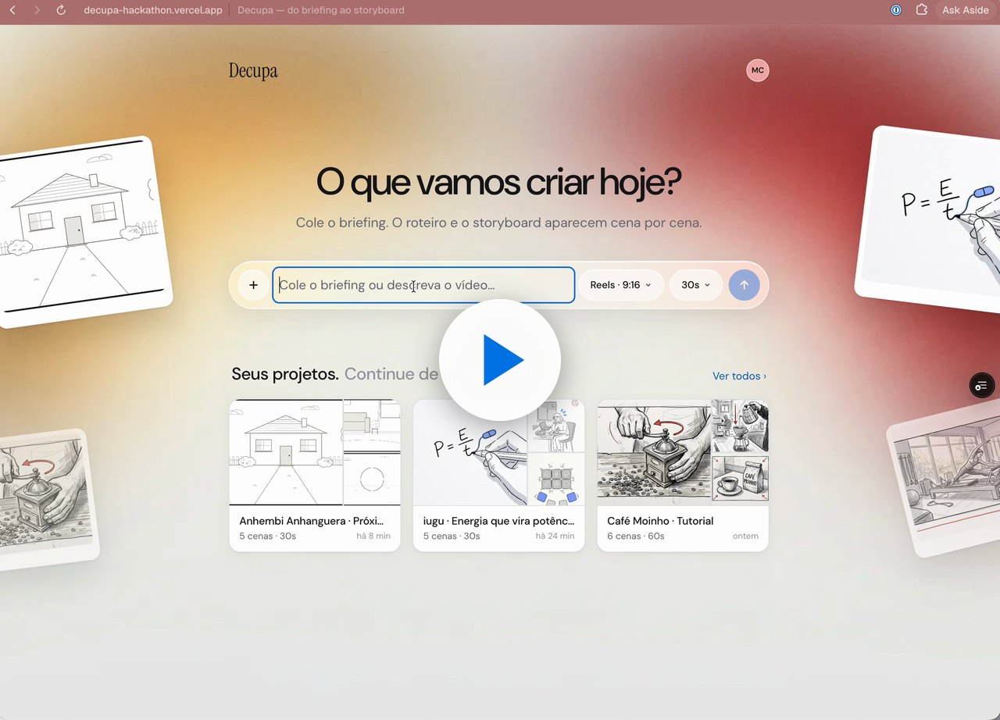

# Decupa — do briefing ao storyboard

Planejador de cenas para criadores. O briefing vira até 6 cenas, cada uma com descrição, fala, duração, plano e movimento de câmera, num canvas onde dá para editar, reordenar e exportar.

O diferencial é a **edição conversacional e incremental**: escreva só o que quer mudar numa cena, ou edite o briefing, e a IA refaz apenas o que foi afetado. Cada mudança vira uma versão, com antes e depois, no estilo dos commits do GitHub.

[](https://cleanshot.com/share/x0frYWc0)

## Rodando

```bash
bun install
vercel dev         # app + funções de IA em api/ (precisa de OPENAI_API_KEY)
bun run dev        # só o app, em http://localhost:5173 (a IA fica fora do ar)
bun run test       # testes (Vitest). Não use `bun test`: ele ignora o Vitest.
bun run build      # build de produção em dist/
```

> Se o `registry.npmjs.org` estiver bloqueado na sua rede, o `.npmrc` do projeto já aponta para o espelho oficial `registry.yarnpkg.com`.

O app abre com três projetos de demonstração: **iugu · Energia que vira potência** (Reels de 30s, 5 cenas), **Café Moinho · Tutorial** e **Studio Vila · Anúncio**. Os desenhos ficam em `public/demo/`. Na primeira abertura depois de uma mudança no seed, os dados locais antigos são apagados e a demonstração é recriada. Para recriar à mão, use **Configurações → Restaurar demo**.

## Roteiro de demonstração

1. **Briefing mudou**: no projeto da iugu, o briefing está na v2. As cenas 2, 3 e 4 têm uma versão “Briefing mudou” com o antes e depois.
2. **Histórico**: a cena 3 (Encaixe) tem quatro versões: a original, dois pedidos por prompt e a mudança de briefing. Use **Restaurar** para criar uma versão nova a partir de uma antiga, sem apagar nada.
3. **Prompt por cena**: selecione uma cena e peça uma mudança na caixa de baixo, ou use os atalhos “Só o desenho”, “Só o diálogo” e “Mais curta”. Arraste uma cena para reordenar, puxe o arco do canto para redimensionar e use **Nota** para colar um lembrete no canvas.
4. **Exportar**: PDF, roteiro em Markdown, shot list em CSV e pacote JSON.

## IA

A OpenAI transforma o briefing em até 6 cenas, refaz uma cena a partir de um pedido curto e reescreve só as cenas afetadas quando o briefing muda, sempre com saída estruturada (Zod). O app não gera imagens: o desenho de cada cena sai do renderizador local (`src/lib/sketch.ts`). Para rodar a IA localmente, defina `OPENAI_API_KEY` e use `vercel dev`, que serve o `api/` junto com o Vite.

Modelo: `gpt-6.1-sol`, definido em `src/lib/ai/server.ts`. As chamadas passam pelas funções em `api/`, então a chave nunca chega ao navegador. O formato de cada pedido e resposta fica em `src/lib/ai/contract.ts`, usado pelos dois lados.

## Linguagem visual dos quadros

- **Cards de storyboard**: número do quadro em círculo, código profissional do plano (`C1 / 0010`, `C1 / 0020`…), painel com borda de tinta, legenda centralizada (fala ou ação) e rodapé com status, enquadramento, movimento e duração.
- **Indicações de câmera em vermelho** sobre o quadro (PAN, TILT, DOLLY IN, ZOOM, TRACKING, TRUCK, GRUA, câmera na mão), geradas a partir do campo “Movimento”. São uma camada separada da imagem e aparecem também no modo ampliado, na apresentação e no PDF. O botão de câmera na barra liga e desliga.
- **Renderizador do modo demo** (`src/lib/sketch.ts`): personagens em tinta escura com rosto, cabelo, figurino e expressão; cenários em lápis mais claro, para separar figura e fundo; enquadramentos coerentes (o médio corta na cintura, o americano no joelho, o close no rosto). Os traços de cada personagem vêm da ficha em Assets (“cabelo cacheado”, “boné”, “camisa xadrez”…), o que mantém a continuidade entre quadros.
- Em desenvolvimento, `#/lab` mostra uma galeria do renderizador com todos os enquadramentos.
- Quem já tinha dados do estilo antigo no navegador recebe as imagens de demonstração redesenhadas automaticamente na primeira abertura. Ids, versões e histórico não mudam.

## Arquitetura e decisões

**Stack:** Vite + React 18 + TypeScript, Tailwind CSS v4, React Flow (`@xyflow/react`), Dexie (IndexedDB), Zustand, AI SDK com a OpenAI nas funções da Vercel, pdf.js e mammoth (anexos do briefing, carregados sob demanda).

- **Sem banco no servidor, por decisão do time**: o estado fica no navegador (IndexedDB). O único código de servidor são as funções de IA em `api/`. O Dexie propaga as mudanças entre abas da mesma origem. Escolhemos Vite em vez de Next.js porque não há páginas renderizadas no servidor.
- **Camada de domínio única** (`src/lib/repo.ts`): toda mutação autoriza o ator pelo papel no projeto e trata revisões e imagens como *append-only*.
- **Versionamento** (`Revision`): hash curto, autor, mensagem, snapshot imutável da cena e, quando veio da IA, o pedido, o modelo, a latência e o resumo do que mudou. Restaurar cria uma nova revisão.
- **Cópia de trabalho × versão**: editar a ficha deixa a cena “sem versão” até alguém salvar a versão.
- **Concorrência**: se a cena ganhou uma versão enquanto a IA trabalhava, `reviseScene` recusa o resultado em vez de sobrescrever.
- **Segurança**: o briefing, os anexos e os pedidos entram no prompt como dados, nunca como instruções.

### Mapa do código

```
src/lib/         domínio: types, db (Dexie), repo (mutações+permissões), context (rótulos de plano e câmera),
                 briefing e scenes (IA), ai/ (openai, contract, server), sketch* (renderizador local), session, seed
api/             funções da Vercel que chamam a OpenAI (plan-briefing, revise-scene, apply-briefing)
src/views/       Home (início: campo de briefing, mural, projetos; peças em home/), Workspace
src/views/workspace/  SceneCanvas (React Flow: briefing, cenas, notas, zoom), nodes/ (BriefingNode, SceneNode, NoteNode),
                 Inspector (Versões e Ficha), PromptBox, ExportMenu, scene (rótulos e formatos)
src/test/        testes de repo (revisões, permissões), scenes (IA por cena e briefing) e do renderizador local
```

## Limitações conhecidas

- **Sem banco no servidor**: autenticação, permissões e “tempo real” valem dentro de **um navegador**, entre abas. As identidades são de demonstração. Para produção, o caminho é trocar o `db` por um backend com auth (por exemplo Supabase: Postgres + RLS, Realtime e Storage com URLs assinadas), mantendo `repo.ts` como contrato.
- **Fora do escopo do MVP**: desfazer/refazer granular na ficha (a restauração de versões já existe).
